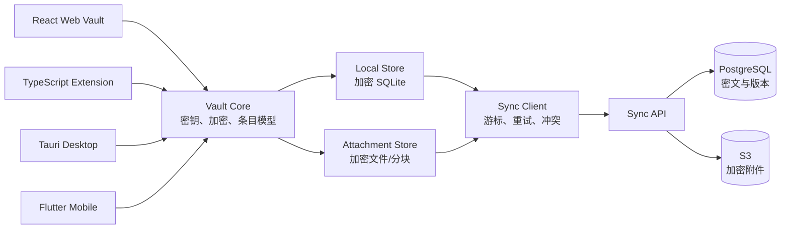
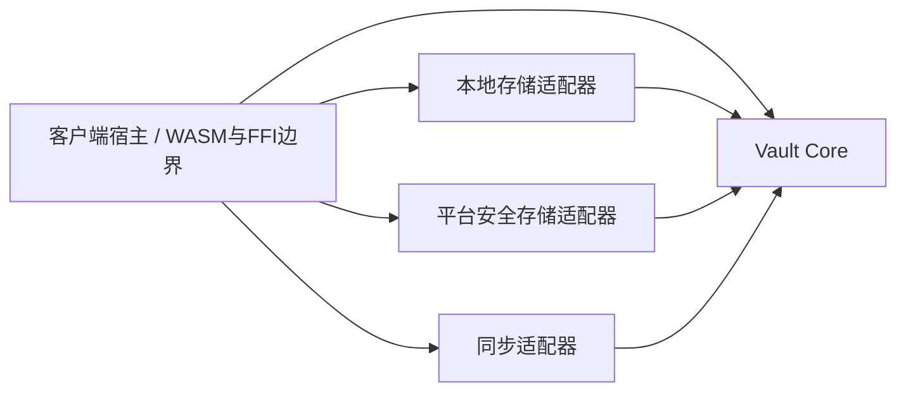

# CitriPass 总体架构

## 1. 逻辑结构

### 核心与适配器的源码依赖

上图描述逻辑组件间的数据流。源码依赖遵循另一条约束：宿主和存储/同步/平台适配器依赖 `vault-core`，核心不依赖这些适配器。

核心只返回领域对象、密文记录、设备包装和附件会话。数据库事务、outbox/cursor 原子提交、网络重试、设备用户认证、附件文件 I/O 和锁定事件后的会话销毁由宿主及适配器负责。JSON 格式是核心的版本化交换契约，不是运行时数据库；不能把备份接口当作逐条存储接口。

## 2. 数据流

### 创建或修改条目

1. 用户在客户端输入内容。
2. 客户端使用 Vault Key 加密内容。
3. 本地数据库在一个事务中写入密文、revision 和 outbox 记录。
4. 有同步配置时，后台任务提交 outbox 中的变更。
5. 服务端校验设备权限并保存密文，不解析 payload。

### 读取条目

1. 客户端读取本地密文。
2. 设备处于解锁状态时取出 Vault Key。
3. 客户端解密并在内存中展示。
4. 锁定、切后台或超时后销毁解锁状态和临时明文。

## 3. 存储模式

| 模式 | 本地数据库 | 同步服务 | 账号 |
| --- | --- | --- | --- |
| Local-only | 有 | 无 | 可无 |
| Self-hosted | 有 | 用户自己的 API/WebDAV/S3 | 可选 |
| Managed cloud | 有 | CitriPass 官方 API | 需要 |

切换模式只改变同步适配器，不改变本地条目格式和密钥格式。

## 4. 服务端边界

服务端可以知道：

- 用户账号和设备关系；
- 条目 ID、保险库 ID、版本和删除标记；
- 密文大小、上传时间和流量；
- 附件数量和加密后的大小。

服务端不能知道：

- 密码、笔记、TOTP 和卡片内容；
- 条目标题和 URL（除非产品未来明确接受这部分元数据泄露）；
- 附件名称和内容；
- Vault Key 和主密码。

## 5. 首期实现边界

首期同时建设 Web Vault、浏览器扩展、Tauri 桌面端、Flutter 移动端和 Go API。它们共享 Rust `vault-core`、加密格式、数据模型和 OpenAPI 契约，不采用先做单端原型再迁移的路线。

不同平台只在系统集成层存在差异：

- Web 和扩展通过 WASM 调用 `vault-core`；
- Tauri 直接调用 Rust 核心；
- Flutter 通过 FFI 调用 Rust 核心；
- 各平台分别接入本地安全存储和本地数据库。

## 6. 可替换点

- 官方 API、自建 API 和兼容 WebDAV/S3 的同步实现都遵循同一个同步适配器接口。
- 原生端的 SQLite 和浏览器端的 IndexedDB 通过同一组本地存储接口接入，不改变 `vault-core` 数据模型。
- 未来可以将逐条同步替换为批量同步，但客户端的条目模型不变。
